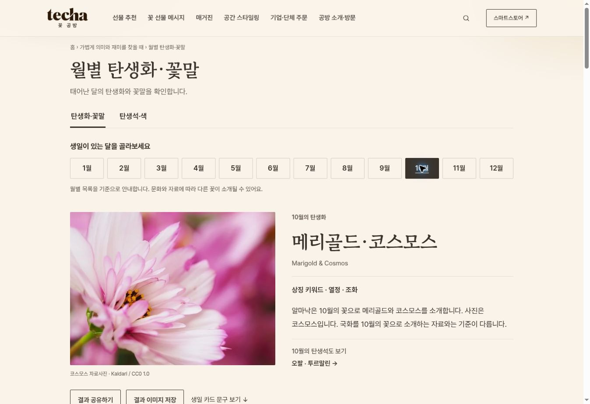
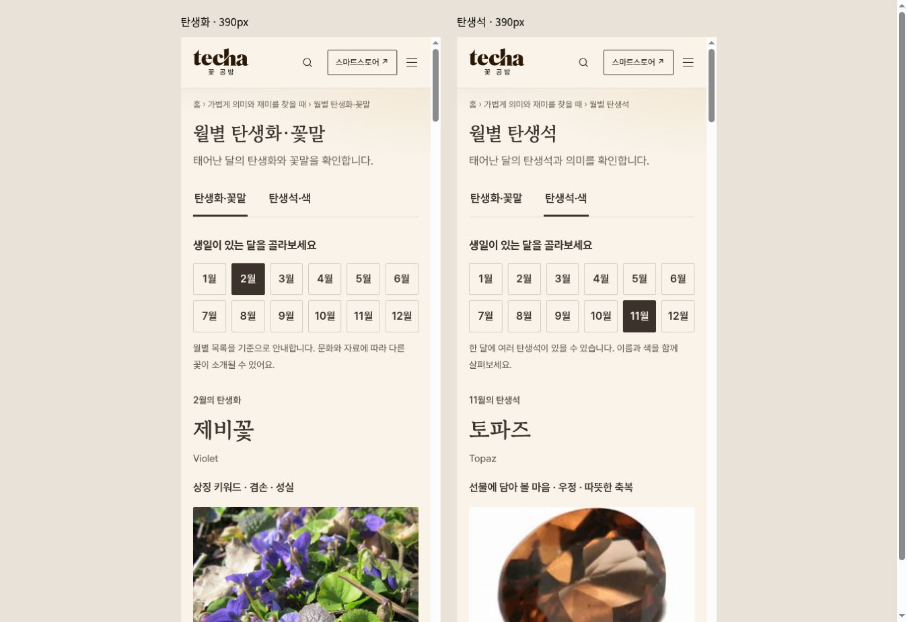
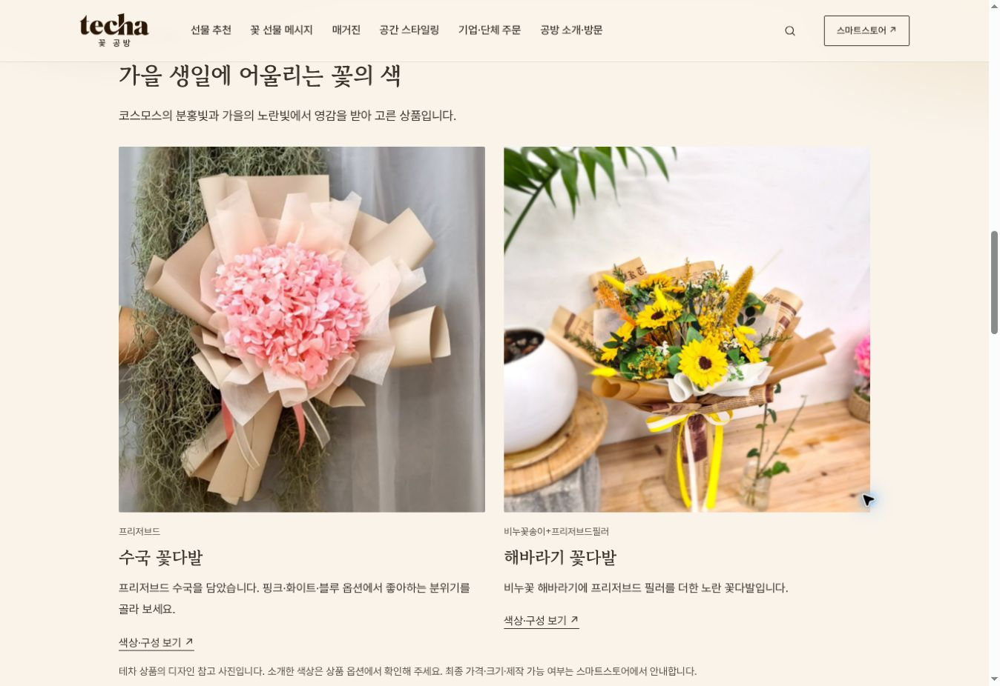

# 테차 탄생화·탄생석 페이지 개선 검토본

검토일: 2026-10-26 · 작업 브랜치: `feature/birth-guides-20261026`

대상은 `/ko/birth-flower/`와 `/ko/birth-stone/` 두 페이지입니다. 기존 테차의 크림색 바탕과 서체를 유지하면서, 정보를 확인한 뒤 카드 문구와 꽃 선물로 이어지도록 구현했습니다. 이 문서는 운영 반영 전 검토 기록입니다. 검토본 완성 후 2026-10-26 사용자의 “모두 반영해줘” 요청으로 GitHub 반영·PR·병합·운영 배포 확인까지 승인받았습니다. 최종 반영 결과는 해당 PR과 완료 안내에 기록합니다.

## 화면

### PC: 월 선택과 결과



### 모바일: 이름과 의미를 먼저 확인



### 상품: 선택한 달의 색과 의미에서 연결



## 구현한 사용자 경험

| 영역 | 바뀐 내용 | 기대하는 도움 |
|---|---|---|
| 월 선택 | 12개월 버튼, 선택 상태 표시, 한국 시간 기준 이번 달 기본값 | 별도의 생년월일 입력 없이 원하는 달 찾기 |
| 결과 | 꽃·보석 사진, 한글·영문 이름, 의미, 함께 소개되는 꽃·보석 | 이름만 나열하던 정보보다 자세히 이해 |
| 모바일 | 이름과 의미를 사진보다 먼저 배치, 48px 월 버튼 | 작은 화면에서도 답을 먼저 확인 |
| 읽을거리 | 이름의 유래, 색 이야기, 선물 전 참고 사항, 색상 예시 | 꽃·보석의 이야기를 선물에 활용 |
| 카드 문구 | 달마다 짧고 담백하게·다정하게·정중하게 3종과 복사 | 문구를 직접 고쳐 카드에 쓰기 |
| 공유·저장 | `?month=2`처럼 달을 유지하는 링크, 1080×1350 PNG 저장 | 선택한 결과를 다른 사람에게 전달 |
| 상품 | 달별 2개 상품, 소재 설명과 추천 이유, 스마트스토어 연결 | 본 정보를 실제 꽃 선물 선택으로 연결 |
| 더 보기 | 같은 달의 탄생화↔탄생석, 매거진, 카드 문구, 관리법, 선물 추천 | 방문자가 다음 정보를 쉽게 찾기 |
| 신뢰 | 출처, 검토일, 사진 이용 조건, FAQ 각 5개 | 서로 다른 목록이나 상징의 차이 이해 |
| 전체 목록 | 12개월의 이름과 의미를 HTML에 포함 | JavaScript가 없어도 전체 목록 읽기 |

문구는 총 72개 항목으로 구성되어 있으나 일부 문구를 여러 달에 공통으로 사용합니다. 72개의 서로 다른 문구를 작성했다는 의미는 아닙니다.

## 정보 기준과 주요 정정

탄생화에는 세계 공통의 단일 공인 목록이 없습니다. 출처가 불분명한 국내 표준이라고 단정하지 않고, Almanac의 월별 목록을 기준으로 Interflora를 함께 참고했습니다. 국내 꽃말 자료는 국립원예특작과학원, 꽃말의 문화적 배경은 RHS를 참고 자료로 제시했습니다.

탄생석은 GIA와 AGS의 월별 안내를 기준으로, 같은 달에 여러 보석이 있는 경우 함께 표시했습니다. 보석의 상징은 선물에 담아 볼 마음으로 표현하고 건강 효능이나 성격·운명 판단으로 단정하지 않았습니다.

| 월 | 탄생화 기준 목록 | 탄생석 목록 |
|---|---|---|
| 1월 | 카네이션 · 스노드롭 | 가넷 |
| 2월 | 제비꽃 · 프리뮬러 | 자수정 |
| 3월 | 수선화 · 존퀼 | 아쿠아마린 · 블러드스톤 |
| 4월 | 데이지 · 스위트피 | 다이아몬드 |
| 5월 | 은방울꽃 · 산사나무꽃 | 에메랄드 |
| 6월 | 장미 · 인동덩굴꽃 | 진주 · 문스톤 · 알렉산드라이트 |
| 7월 | 라크스퍼 · 수련 | 루비 |
| 8월 | 글라디올러스 · 포피 | 페리도트 · 스피넬 · 사도닉스 |
| 9월 | 아스터 · 나팔꽃 | 사파이어 |
| 10월 | 메리골드 · 코스모스 | 오팔 · 투르말린 |
| 11월 | 국화 | 토파즈 · 시트린 |
| 12월 | 수선화 · 호랑가시나무 | 터키석 · 탄자나이트 · 지르콘 |

사진은 해당 달에 함께 소개되는 꽃·보석 중 한 가지 표본입니다. 7월 라크스퍼 자료사진은 Delphinium glaucum, 9월 아스터 사진은 여러해살이 아스터 표본으로 안내합니다. 12월 수선화 사진은 Narcissus의 예로 사용하며 페이퍼화이트 품종이라고 단정하지 않습니다. 사파이어 사진은 여러 색의 원석임을 표시했습니다.

10월은 국화를 소개하는 다른 자료와 목록이 달라지는 점을 본문과 관련 글에서 설명합니다. 꽃말도 국가·문화·자료에 따라 달라질 수 있음을 함께 안내합니다.

## 자연스러운 상품 소개 방식

정보 → 의미·색 → 카드 문구 → 테차 상품 순서로 이어집니다. 추천 문장은 그 달의 정보와 연결했습니다. 예를 들어 10월에는 코스모스의 분홍과 가을의 노랑을 소개한 뒤 핑크 수국 꽃다발과 노란 해바라기 꽃다발을 보여 줍니다.

- 1월 카네이션 관련 상품, 6월 장미 상품은 실제 사용 소재를 설명합니다.
- 다른 꽃을 추천할 때는 탄생화의 색·분위기에서 영감을 받은 제안이라고 밝힙니다.
- 탄생석 페이지는 색을 참고한 꽃 선물이며 실제 보석이 포함되어 있지 않다고 안내합니다.
- 보유한 테차 상품 사진과 승인된 기존 상품 이미지를 재사용했습니다. 수국은 분홍·크림·블루 사진을 달별 추천 색에 맞춰 배치했습니다.
- 링크는 `data/store-links.json`의 기존 네이버 마케팅 링크를 사용합니다. 가격과 재고를 고정해 싣지 않고 최종 옵션·구성은 스마트스토어로 연결합니다.

## 출처와 사진

- [The Old Farmer’s Almanac: Birth Month Flowers](https://www.almanac.com/content/birth-month-flowers-and-their-meanings)
- [Interflora: Birth Flowers](https://www.interflora.co.uk/blog/flower-guides/birth-flowers)
- [국립원예특작과학원: 꽃말사전](https://www.nihhs.go.kr/usr/persnal/Flower_library.do)
- [RHS: The Language of Flowers](https://www.rhs.org.uk/education-learning/libraries-at-rhs/articles/the-language-of-flowers)
- [GIA: Birthstones](https://www.gia.edu/birthstones)
- [AGS: Birthstones](https://www.americangemsociety.org/birthstones/)

월별 상세 출처는 `data/birth-guides.json`과 각 결과의 출처 링크에 기록했습니다. 본문은 출처를 참고해 새로 정리했고, 카드 문구·꽃 색 조합·상품 추천은 테차의 편집 제안입니다.

꽃·보석 자료사진 23개는 파일별 CC0 또는 퍼블릭 도메인 이용 조건을 확인했습니다. 저작자·원문·이용 조건·검토일·크기·파생 작업은 `data/birth-guide-photo-credits.json`에 기록했습니다. 사진 아래와 페이지 하단에서도 원문을 확인할 수 있습니다. 일부 자료사진은 이용이 허용된 원문 표시 이미지를 잘라 WebP로 변환했습니다. 테차 상품 사진과 자료사진은 용도를 구분했습니다.

## 검증 결과

### 통과한 자동 확인

```sh
node scripts/check-birth-guides.js
node scripts/build-birth-guides.js --check
node scripts/build-tool-products.js --check
node scripts/build-related.js --check
node --check assets/js/birth-guide.js
node --check scripts/build-birth-guides.js
node --check scripts/lib/birth-guide.js
git diff --check
```

- 24개월 항목, 문구 72개 항목, 달마다 상품 2개, 공식 상품 링크 형식, 이미지 파일, 이용 조건, 정적 전체 목록, 인라인 데이터 일치 확인.
- WebP 23개 전부 실제 디코딩 확인. 검증 중 발견한 8월 꽃 이미지의 빈 파일을 복구한 뒤 재확인.
- 기존 상품·관련 링크 생성기의 덮어쓰기로 새 UI가 사라지지 않도록 생성 책임 분리.

### 브라우저에서 확인

- 탄생화 12개월, 탄생석 12개월을 각각 눌러 이름·선택 상태·상품 2개·사진 표시 확인.
- 선택한 달을 유지하는 탄생화↔탄생석 이동과 뒤로 가기 확인.
- 유효하지 않은 `month=99` 입력 시 이번 달로 복귀 확인.
- 문구 복사와 공유 링크 복사의 성공 상태 확인. 자동 복사가 어려운 브라우저에는 선택 가능한 텍스트 상자 제공.
- 2월 자수정과 이름이 긴 12월 탄생석의 PNG를 실제 다운로드해 크기·글자 배치 확인.
- 390px 프레임에서 두 페이지 확인. 스크롤바를 제외한 내부 폭 375px에서 가로 넘침 없음, 월 버튼 높이 48px 확인.
- 마지막 상품 사진 조정 후 10월 핑크 수국 사진이 반영되는지 브라우저에서 재확인.

실제 iPhone·Android 기기와 네이티브 공유 시트는 검증하지 않았습니다. 브라우저의 링크 복사 경로를 확인했습니다. 전환율 증가는 아직 측정하지 않았습니다.

### 기존 전체 검사 차이

`node scripts/build-chrome.js --check`는 이번 변경과 무관한 기존 4개 파일의 차이로 통과하지 않습니다. 두 탄생 페이지의 공통 헤더·페이지 제목·푸터 차이는 없습니다.

- `blog/farewell-greeting-message/index.html`, `blog/sunflower-painting-meaning/index.html`: 기존 유튜브 링크 차이.
- `blog/index.html`, `message/index.html`: 기존 생성 블록의 줄바꿈 차이.

관련 없는 발행 페이지와 공통 영역은 수정하지 않았습니다.

## 유지보수와 변경 파일

| 파일 | 역할 |
|---|---|
| `data/birth-guides.json` | 24개월 콘텐츠·팔레트·문구·상품·월별 이미지 선택 |
| `data/birth-guide-photo-credits.json` | 자료사진 이용 조건·저작자 기록 |
| `assets/images/birth-guide/*.webp` | 자료사진 23개 |
| `assets/css/birth-guide.css` | 두 페이지에 한정한 반응형 스타일 |
| `assets/js/birth-guide.js` | 정적·동적 공유 렌더러, 월 선택, 복사·공유·저장·이벤트 |
| `scripts/lib/birth-guide.js` | 상품 카탈로그·스토어 링크·자료 결합 |
| `scripts/build-birth-guides.js` | 두 페이지 생성, 기존 공통 영역·관련 링크 보존 |
| `scripts/check-birth-guides.js` | 데이터·파일·출력 검증 |
| `data/tool-product-links.json`, `scripts/build-tool-products.js` | 두 월별 페이지의 상품 생성 책임 분리 |
| `ko/birth-flower/index.html`, `ko/birth-stone/index.html` | 생성한 최종 페이지 |
| `docs/birth-guides-review-20261026.md`, 화면 3장 | 검토 기록 |

내용이나 상품을 바꾸면 아래 순서로 재생성합니다.

```sh
node scripts/build-birth-guides.js
node scripts/check-birth-guides.js
node scripts/build-birth-guides.js --check
node scripts/build-tool-products.js --check
```

추가한 분석 이벤트는 `birth_month_select`, `birth_message_copy`, `birth_result_share`, `birth_card_save`, `birth_product_click`입니다. 기존 `TECHA.track`을 사용하며 가이드 종류·월과 관련 상품 또는 문구 유형을 전달합니다. 배포 후 월 선택→상품 클릭과 문구 복사 이용률을 비교하면 후속 개선의 근거로 사용할 수 있습니다.

## 운영 반영 전 확인

기준 `main`: `e338e804d4893ef5408624ccc8153ea494a017d2`. 최종 커밋 전 원격 `main`을 다시 확인했습니다. 이번 작업은 공통 발행 핫스폿·배포 설정·자동 발행 흐름을 변경하지 않습니다.

저장소 `AGENTS.md`는 “Use a dedicated working branch, and do not create a PR or merge unless explicitly requested.”라고 지시합니다. 또한 작업 브랜치 푸시가 운영 빌드를 만든 이력이 있어, 브랜치 푸시도 운영에 노출될 수 있습니다. 2026-10-26 사용자의 명시적인 운영 반영 요청을 받았으므로 전용 작업 브랜치에서 PR로 병합하고, 브랜치 반영 후와 병합 후 공개 페이지를 확인합니다.
